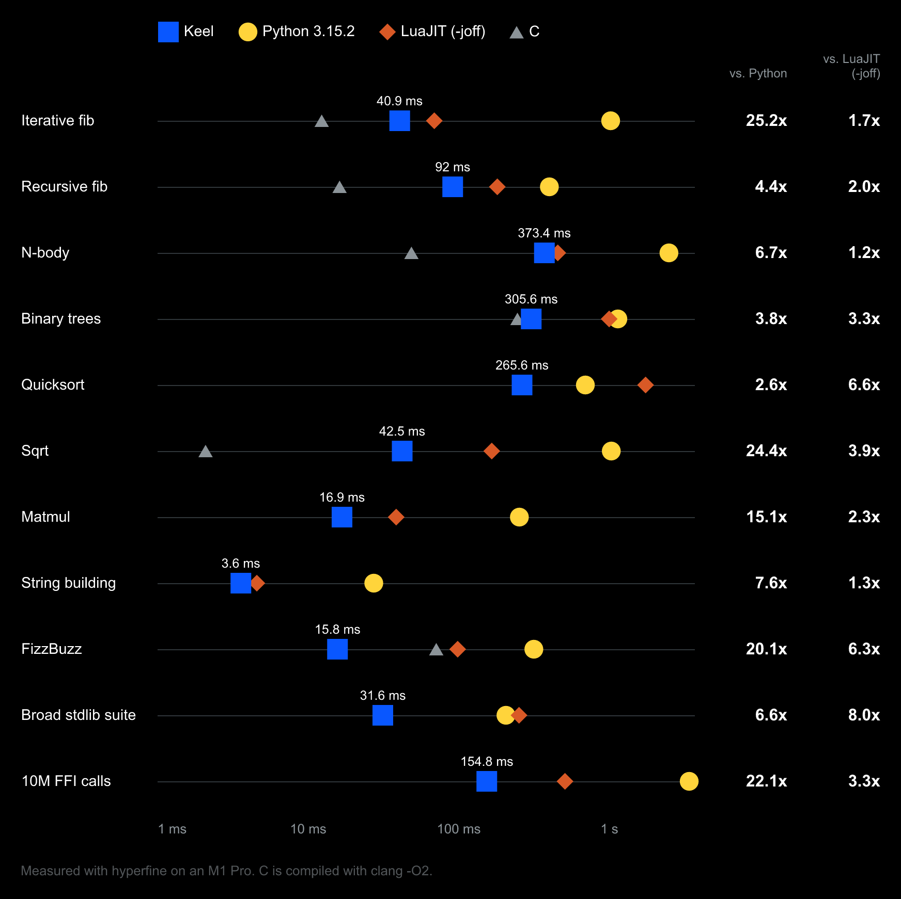

> [!WARNING]
> Keel is under active development

**Keel** is a very fast, statically-typed interpreted language that aims to combine Rust-like syntax with Python's ease-of-use.

Its goal is to provide a faster alternative to Python that sits closer to low-level languages while remaining accessible to a wide audience.

**[Contributions and issues](CONTRIBUTING.md) are very welcome!**

[Website](https://keel-lang.com)
[Documentation](https://docs.keel-lang.com)
[Install Keel](#installation)
[Try Keel in your browser](https://keel-lang.com/playground)

## Why Keel?

- **Fast**: Across [the benchmarks](BENCHMARKS.md), on average, Keel is **~8x faster than Python**, and **~2.7x faster than LuaJIT's interpreter (-joff)**.
- **Familiar syntax**: Rust-like, with Python's ease-of-use
- **Statically typed, optional annotations**: full type inference, static type checking, polymorphism
- **FFI support**: call functions from any dynamic library easily by declaring their signatures in a `dylib` block. Per-call overhead is **~3.5x lower than LuaJIT's interpreter (-joff)** and **~22x lower than Python**.
- **Embeddable in other programs through a C ABI**
- **Built-in REPL**

Keel also has a [VS Code extension](https://marketplace.visualstudio.com/items?itemName=horacehoff.keel) that provides syntax highlighting.

[Browse examples](examples/)

## Quick showcase

```rust
struct Point { x: int, y: int }

fn add(a, b) {
    return a + b;
}

fn main() {
    let p = Point { x: 3, y: 4 };
    print(add(p.x, p.y)); // 7
    print(add("Hello, ", "world!")); // Hello, world!

    let nums = [4, 2, 6, 1, 7];
    if nums[0] == 4 {
        nums.sort();
        print(if nums[0] == 1 { nums[0..3] } else { -1 }); // [1,2,4]
    } else {
        throw("Error!");
    }
}
```


## Installation

You can install Keel manually by downloading the desired version from the [releases page](https://github.com/horacehoff/keel/releases/latest), or use one of the following installation commands.

### macOS / Linux

```sh
curl -fsSL https://raw.githubusercontent.com/horacehoff/keel/main/install.sh | sh
```

### Windows

Run the following command in a PowerShell terminal. Administrator privileges are not required to run this command or the installation script.

```powershell
irm https://raw.githubusercontent.com/horacehoff/keel/main/install.ps1 | iex
```

## Usage

```sh
keel program.kl    # Run a file
keel               # Start the REPL
keel -v/--version  # Print version
keel -h/--help     # Print help
```

## Benchmarks


### Build from source (without PGO)
Make sure [Rust](https://rustup.rs/) is installed.

```sh
git clone https://github.com/horacehoff/keel && cd keel && rustup toolchain install && cargo build --release
./target/release/keel myfile.kl
```

## Near-future roadmap
The roadmap can be found [here](ROADMAP.md).

Ad astra per aspera!