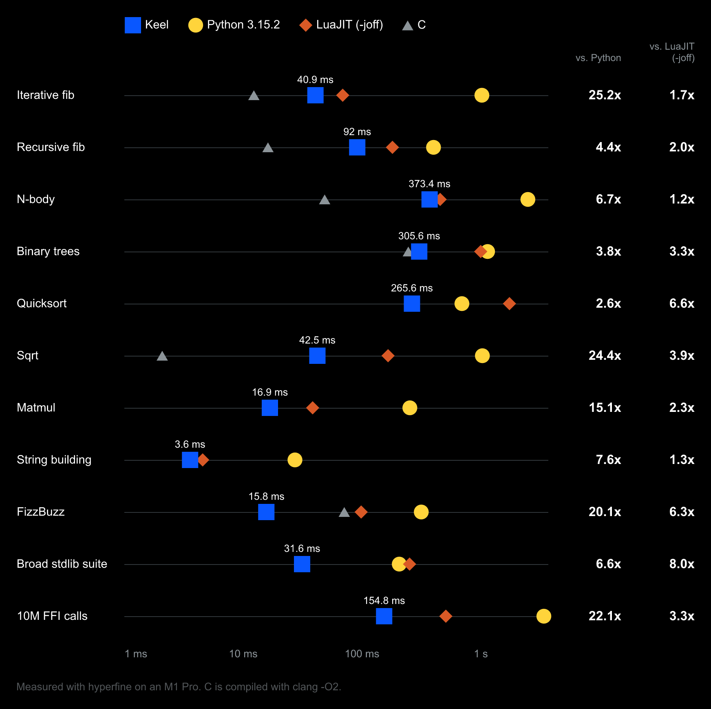

# Get started

## What, and why is Keel ?

!!! warning

    Keel is experimental and under active development (this documentation too). Little is set in stone.

Keel is a very fast, statically-typed interpreted language that aims to combine Rust-like syntax with Python's ease-of-use.

Its goal is to provide a faster alternative to Python that sits closer to low-level languages while remaining accessible to a wide audience. In other words, you should like Keel whether you're a seasoned Rust developer or you've barely touched Python and are completely new to programming.

## Why Keel?

- **Fast**: Across [the benchmarks](https://github.com/horacehoff/keel/blob/main/BENCHMARKS.md), on average, Keel is **~8x faster than Python**, and **~2.7x faster than LuaJIT's interpreter (-joff)**.
- **Familiar syntax**: Rust-like, with Python's ease-of-use
- **Statically typed, optional annotations**: full type inference, static type checking, polymorphism
- **FFI support**: call functions from any dynamic library easily by declaring their signatures in a `dylib` block. Per-call overhead is **~3.5x lower than LuaJIT (-joff)** and **~22x lower than Python**.
- **Embeddable in other programs through a C ABI**
- **Built-in REPL**

The goal of this documentation / tutorial is to show Keel's syntax and how it works by example more than by theory.

## Installation

You can install Keel manually by downloading the desired version from the [releases page](https://github.com/horacehoff/keel/releases/latest), or use one of the following installation commands.

### On macOS / Linux

Keel provides a macOS / Linux installer, which you can use to download and install Keel by running the following command in your terminal: 
`#!bash curl -fsSL https://raw.githubusercontent.com/horacehoff/keel/main/install.sh | sh`

This will install the latest Keel version in `$HOME/.keel`.

### On Windows

Run the following command in a PowerShell terminal. Administrator privileges are not required to run this command or the installation script.

`#!powershell irm https://raw.githubusercontent.com/horacehoff/keel/main/install.ps1 | iex`

This will install the latest Keel version for the current user in `%USERPROFILE%\.keel`.

## Usage

Once installed, you can use the `keel` command like any other:

- To run the REPL, run: `#!bash keel`
- To run a `.kl` file [^extension], run: `#!bash keel file.kl`
- To display Keel's current version, run: `#!bash keel -v` or `#!bash keel --version`
- To display the available commands, run: `#!bash keel -h` or `#!bash keel --help`

[^extension]: Keel files have the `.kl` file extension.
*[REPL]: Read-Eval-Print-Loop

Keel also has a [VS Code extension](https://marketplace.visualstudio.com/items?itemName=horacehoff.keel) that provides syntax highlighting.

## Benchmarks
{ loading=lazy }
